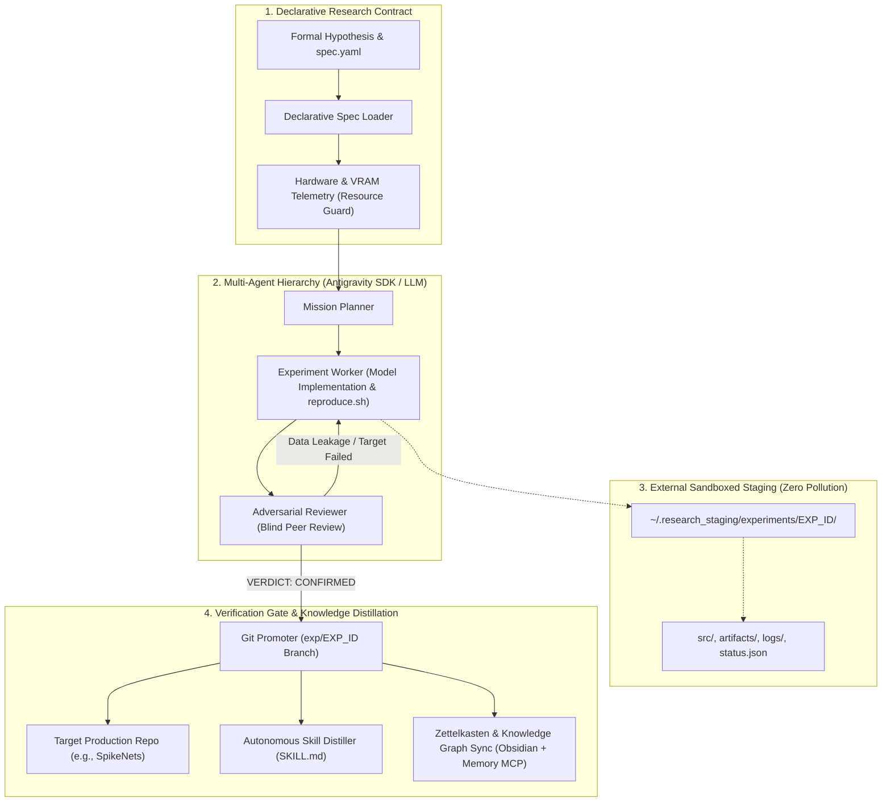

# HYRA: Autonomous AI Research Harness & Experimentation Platform

[](https://www.python.org/)
[](https://modelcontextprotocol.io)
[](LICENSE)
[](#core-architectural-invariants)
[](#multi-tier-agent-hierarchy)

An enterprise-grade autonomous scientific experimentation harness engineered for Large Language Models and Agentic AI workflows (Google Antigravity SDK, Claude, Cursor, OpenAI-compatible runtimes).

HYRA establishes an isolated, hypothesis-driven contour that enforces **mathematical rigor**, **zero project pollution**, and **adversarial anti-data-leakage verification** for continuous machine learning and quantitative research.

---

## Core Problems Solved

When autonomous coding agents conduct deep learning or quantitative experiments, common failure modes include:

1. **Project Pollution**: Agents litter the production repository tree with scratch scripts, unversioned checkpoints, corrupt datasets, and raw execution logs.
2. **Data Leakage & Phantom Metric Gains**: LLM workers frequently evaluate on training sets, fit preprocessors across train/test splits, or hallucinate convergence gains.
3. **Knowledge Evaporation**: Promising numerical formulations and algorithmic discoveries vanish across ephemeral context windows.
4. **Unbounded Resource Exhaustion**: Runaway training loops trigger GPU out-of-memory (OOM) panics or zombie processes.

HYRA eliminates these pathologies by introducing a disciplined, multi-agent lifecycle backed by the **Model Context Protocol (MCP)**.

---

## Architectural Overview



---

## Core Architectural Invariants

### 1. Zero Project Pollution
The production repository workspace is immutable during exploratory phases. All exploratory scripts, parameter grids, checkpoints, and logs are restricted to an external staging area:
`~/.research_staging/experiments/<EXP_ID>/`

### 2. Double Verification Gate (Blind Peer Review)
No model or algorithmic modification may be promoted to the production tree without passing an independent adversarial audit:
- **Zero Data Leakage Check**: Verifies that standardizers/scalers are fitted solely on training splits, and validation partitions remain untouched until final inference.
- **Reproducibility Guarantee**: The worker must generate a standalone `reproduce.sh` script with deterministic random seeds that terminates with code `0`.
- **Contract Fulfillment**: Verifies that empirical gains exceed the `required_gain` threshold set in `spec.yaml` with statistical significance ($p < 0.01$).

### 3. Persistent Knowledge & Zettelkasten Graph
HYRA bridges agent execution with long-term memory systems:
- Auto-generates structured Obsidian Zettelkasten experiment cards and maintains index registries.
- Registers semantic nodes and relationships in the `Memory MCP` graph.

### 4. Autonomous Skill Distillation
Confirmed algorithmic routines and numerical solvers are automatically compiled into permanent, self-documenting agent skills (`SKILL.md`) in `~/.gemini/config/skills/`, ensuring that future agent generations inherit verified capabilities.

---

## Multi-Tier Agent Hierarchy

HYRA structures agent execution across four specialized roles:

| Role | Subagent Name | Responsibilities | Tool Capabilities |
| :--- | :--- | :--- | :--- |
| **Mission Supervisor** | `mission_planner` | Decomposes declarative contracts into execution milestones; supervises review feedback loops | Subagent delegation, filesystem read/write |
| **Research Engineer** | `experiment_worker` | Implements baselines and modifications; ensures memory discipline and generates `reproduce.sh` | Bash execution, filesystem read/write |
| **Impartial Auditor** | `adversarial_reviewer` | Performs blind reproduction, audits data splits for leakage, issues `CONFIRMED` or `FALSIFIED` | Bash execution, file inspection, audit logging |
| **Platform Orchestrator** | `Overall Layer` | Manages hardware telemetry, detached process lifecycle, and MCP tool invocations | Google Antigravity SDK / OpenRouter / Gemini |

---

## Installation

### Prerequisites
- Python 3.10 or higher
- Linux (x86_64 or ARM64)

### Using uv (Recommended)

```bash
git clone https://github.com/ijstt/hyra-research.git
cd hyra-research
uv venv
source .venv/bin/activate
uv pip install -e ".[dev,mcp]"
```

### Using pip

```bash
pip install -e ".[dev,mcp]"
```

---

## Command-Line Interface (CLI)

HYRA exposes a unified CLI for managing experiment lifecycles:

```bash
# 1. Initialize a new isolated experiment in staging
hyra init EXP-002 --title "Adaptive Threshold SNN" --project SpikeNets

# 2. Run the experiment synchronously
hyra run EXP-002

# 3. Or launch detached execution in the background (leaves terminal free)
hyra run EXP-002 --background

# 4. Check experiment liveness, PID, logs, and audit verdict
hyra status EXP-002

# 5. Promote a confirmed experiment to target Git repository on a new branch
hyra promote EXP-002

# 6. Distill a verified algorithm into a permanent agent skill
hyra distill \
  --name fast_laplace_solver \
  --desc "High-performance Gaver-Stehfest numerical Laplace inverter" \
  --guide "Use when computing first passage times for continuous SDEs." \
  --example path/to/solver.py
```

---

## Model Context Protocol (MCP) Server

HYRA provides a native Model Context Protocol server exposing 7 tools for AI agent orchestration:

### MCP Server Tools

1. `hyra_init_experiment(exp_id, title, project_name)`: Creates isolated staging workspace, populates `spec.yaml`, creates Obsidian card, and logs Memory MCP entity.
2. `hyra_start_experiment(exp_id, background=True)`: Initiates the multi-agent research pipeline (Mission Planner -> Worker -> Adversarial Reviewer).
3. `hyra_check_status(exp_id)`: Reports execution state, background PID, recent logs, run history metrics, and audit verdict.
4. `hyra_check_leakage(path)`: Performs static AST code audit for data leakage vulnerabilities (pre-split fit, lookahead bias, target leakage).
5. `hyra_verify_proof(path, disallow_sorry=True)`: Formally verifies Lean 4 mathematical proof files and checks for unproven 'sorry' assertions.
6. `hyra_promote_experiment(exp_id)`: Enforces zero-leakage and formal proof gates, then transfers production modules into target Git repository.
7. `hyra_distill_skill(name, description, guidelines, example_code)`: Compiles verified implementations into permanent agent skill repositories.

### Configuration in MCP Clients

Add HYRA to your MCP configuration file (e.g. `mcp_config.json`, `claude_desktop_config.json`):

```json
{
  "mcpServers": {
    "hyra-research": {
      "command": "hyra-mcp",
      "args": [],
      "env": {
        "HYRA_STAGING_DIR": "/home/user/.research_staging",
        "HYRA_DEFAULT_PROJECT": "/home/user/SpikeNets"
      }
    }
  }
}
```

---

## Declarative Contract Schema (`spec.yaml`)

Every experiment is governed by a declarative YAML contract:

```yaml
experiment_id: "EXP-001"
title: "Exponential Leaky Integrate-and-Fire with Dynamic Adaptive Threshold"
project_path: "/home/user/SpikeNets"
date: "2026-11-02"

hypothesis:
  statement: "Adaptive membrane thresholds mitigate high-frequency false positives while maintaining precision >= 95%."
  mathematical_formulation: |
    dV_t = -(V_t - V_rest) / tau_m * dt + R * I_t * dt + sigma * dW_t
    dTheta_t = -(Theta_t - Theta_0) / tau_theta * dt + delta_theta * dS_t

falsification:
  target_metric: "f1_score"
  baseline_metric: 0.812
  required_gain: 0.05       # Minimum 5% relative improvement
  max_p_value: 0.01         # Statistical significance requirement
  numerical_stability_check: true

compute_budget:
  max_runtime_minutes: 60
  gpu_memory_limit_mb: 8192
  allow_cpu_fallback: false
  random_seeds: [42, 137, 2026]

execution_steps:
  - "1. Synthesize benchmark data without future look-ahead"
  - "2. Evaluate baseline LIF model and store artifacts"
  - "3. Implement adaptive dynamic threshold LIF"
  - "4. Run cross-validation over fixed seeds"
  - "5. Output reproduce.sh and invoke adversarial reviewer"

promotion:
  target_module_path: "spikenets/models/adaptive_lif.py"
  target_notebook_path: "notebooks/demo_adaptive_lif.ipynb"
```

---

## Configuration & Environment Variables

HYRA adapts to any environment via `hyra.yaml` or standard environment variables:

| Variable | Default Value | Description |
| :--- | :--- | :--- |
| `HYRA_STAGING_DIR` | `~/.research_staging` | Directory for isolated experiment workspaces |
| `HYRA_OBSIDIAN_VAULT` | `~/OBSIDIAN/Antigravity_Memory/Research` | Path to Obsidian vault (optional) |
| `HYRA_MEMORY_FILE` | `~/.gemini/antigravity/memory.jsonl` | Path to Memory MCP graph file (optional) |
| `HYRA_SKILLS_DIR` | `~/.gemini/config/skills` | Directory for distilled agent skills |
| `HYRA_DEFAULT_PROJECT` | `~/SpikeNets` | Default target repository for promotions |
| `HYRA_LLM_MODEL` | `gemini-2.5-flash` | Default LLM model identifier |

---

## Testing & Quality Assurance

HYRA includes a comprehensive suite of unit and integration tests:

```bash
# Run test suite
pytest tests -v
```

Test coverage includes:
- Dynamic configuration resolution and environment overrides.
- Declarative contract validation and error diagnosis.
- Hardware telemetry (CPU, RAM, GPU VRAM) and sandboxed timeout guards.
- Promotion gate invariants (`audit_log.md` confirmation and `reproduce.sh` validation).
- Automated Git branch creation and commit operations.
- Skill distillation and Markdown frontmatter formatting.

---

## Repository Structure

```
hyra-research/
├── src/
│   └── hyra/
│       ├── __init__.py          # Public API exports
│       ├── cli.py               # Unified CLI interface (hyra)
│       ├── config.py            # Dynamic configuration and environment manager
│       ├── engine.py            # Multi-agent orchestrator (Antigravity SDK / LLM)
│       ├── formal_verifier.py   # Lean 4 formal theorem verification engine
│       ├── leakage_detector.py  # AST static analyzer for data leakage
│       ├── mcp_server.py        # Model Context Protocol stdio server
│       ├── promoter.py          # Git promotion gate and verification engine
│       ├── resource_guard.py    # Hardware telemetry and sandboxed process runner
│       ├── run_tracker.py       # Append-only run ledger (runs.jsonl)
│       ├── scaffolding.py       # Isolated workspace initialization
│       ├── skill_distiller.py   # Autonomous skill compiler (SKILL.md)
│       ├── skill_exporter.py    # ZIP exporter for Agensi, Claude, and Cursor
│       └── spec_loader.py       # YAML contract validation
├── skills/
│   └── anti_leakage_researcher/ # Official Agensi.io distribution skill package
├── templates/
│   ├── spec_template.yaml       # Canonical declarative contract template
│   └── experiment_card.md       # Obsidian Zettelkasten experiment card template
├── examples/
│   └── exp_001_snn_baseline/    # End-to-end reproducible experiment reference
├── tests/
│   ├── test_config.py
│   ├── test_e2e_research_lifecycle.py
│   ├── test_formal_verifier.py
│   ├── test_leakage_detector.py
│   ├── test_promoter.py
│   ├── test_resource_guard.py
│   ├── test_run_tracker.py
│   ├── test_scaffolding.py
│   ├── test_skill_distiller.py
│   ├── test_skill_exporter.py
│   └── test_spec_loader.py
├── pyproject.toml               # PEP 621 package build configuration
├── README.md                    # Platform documentation and architecture
└── LICENSE                      # MIT License
```

---

## License

This project is licensed under the MIT License — see the [LICENSE](LICENSE) file for details.
